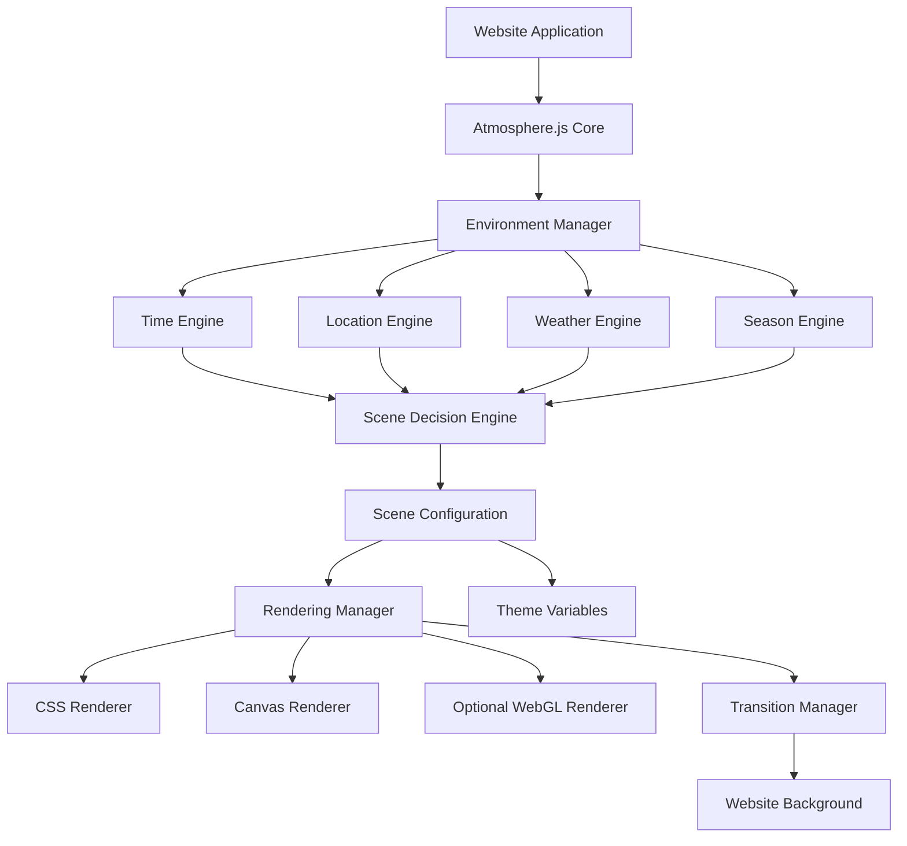

# Atmosphere.js — Implementation Plan

**Project type:** Open-source JavaScript / TypeScript package  
**Purpose:** Dynamically adapt a website's background to the user's local time, weather, location, and regional season.  
**Target distribution:** npm  
**Status:** Proposed implementation roadmap

---

## 1. Product vision

Build a reusable, framework-independent environmental background engine that changes a website's visual atmosphere according to local environmental conditions.

The package should provide:

- Automatic local-time detection.
- Optional location detection.
- Weather-aware scenes.
- Regional and configurable seasonal profiles.
- Animated sky and weather effects.
- Smooth transitions between scenes.
- Theme colors exposed through CSS variables.
- Manual overrides and custom presets.
- Graceful behavior when location permission, network access, or weather data is unavailable.
- Vanilla JavaScript / TypeScript support and a separate React integration.

The goal is to make integration straightforward for application developers while keeping the underlying engines independently configurable.

## 2. Product scope and modules

| Module | Responsibilities |
|---|---|
| Time Engine | Local time, timezone, day/night periods, sunrise and sunset |
| Location Engine | Coordinates, timezone and hemisphere |
| Weather Engine | Current weather, weather codes, precipitation and cloud cover |
| Season Engine | Astronomical seasons and configurable regional climate profiles |
| Scene Decision Engine | Combine environmental inputs into a scene configuration |
| Rendering Engine | Sky, clouds, sun, moon, rain, snow, fog and stars |
| Transition Engine | Smoothly transition between scenes |
| Theme Engine | Generate palettes and CSS custom properties |
| Accessibility Engine | Respect reduced-motion preferences and user settings |
| Provider Adapters | Integrate weather and other data providers |

### Initial scene examples

| Time | Weather | Scene |
|---|---|---|
| Morning | Clear | Sunrise |
| Morning | Rain | Rainy morning |
| Afternoon | Clear | Sunny day |
| Afternoon | Cloudy | Cloudy afternoon |
| Evening | Clear | Golden sunset |
| Evening | Rain | Rainy sunset |
| Night | Clear | Starry night |
| Night | Storm | Night thunderstorm |

The scene decision engine should compose reusable visual layers instead of requiring a unique renderer for every possible combination.

## 3. Technical architecture

### Proposed flow



### Architectural principles

1. Environmental data collection, scene selection and visual rendering must be separate.
2. The core package must not require React.
3. Weather providers must be replaceable through adapters.
4. Renderers must be independently selectable.
5. WebGL must remain optional.
6. All browser permissions must be requested transparently and only when needed.
7. The package must have sensible local fallbacks when external data is unavailable.

## 4. Technology stack

| Layer | Technology | Purpose |
|---|---|---|
| Language | TypeScript | Typed implementation and public API |
| Build | tsup | Package bundling |
| Rendering | CSS + Canvas 2D | Backgrounds and visual effects |
| Advanced rendering | Optional WebGL | Advanced 3D environments |
| Weather | Open-Meteo adapter | Weather data integration |
| Location | Browser Geolocation API | Optional coordinate detection |
| Time | Native Date + Intl | Local time and timezone |
| React | React hooks/provider | Optional React integration |
| Unit testing | Vitest | Unit and module tests |
| Browser testing | Playwright | Browser and integration testing |
| Documentation | VitePress | Developer documentation |
| CI/CD | GitHub Actions | Automated checks and releases |
| Registry | npm | Package distribution |

### Dependency principles

- Keep mandatory runtime dependencies close to zero.
- React is an optional peer dependency.
- Weather providers are pluggable.
- Renderers are independently selectable.
- Avoid making WebGL mandatory.
- Audit third-party licenses and dependencies before release.

## 5. Development roadmap

Estimated schedule for one developer working consistently. These estimates are planning assumptions, not delivery guarantees.

| Phase | Scope | Estimate |
|---|---|---:|
| 1. Project foundation | Repository, TypeScript, build, linting and tests | 2–3 days |
| 2. Environment engines | Time, location, timezone, hemisphere, season and state model | 4–5 days |
| 3. Weather integration | Open-Meteo adapter, mapping, caching, refresh and fallback | 3–4 days |
| 4. Scene decision engine | Rules, priorities, scene configuration and overrides | 3–4 days |
| 5. Rendering engine | CSS/Canvas renderers, sky, sun, moon, clouds and weather effects | 7–10 days |
| 6. Themes and transitions | Palettes, CSS variables, transitions and reduced motion | 3–4 days |
| 7. Developer integrations | Vanilla API, React integration, events and declarations | 3–5 days |
| 8. Testing and optimization | Unit, integration, browser, performance and failure testing | 4–6 days |
| 9. Demo and documentation | Interactive demo, playground, guides and API reference | 4–5 days |
| 10. Release | Name check, audits, validation, GitHub and npm release | 2–3 days |

**Estimated total: 35–49 days.** Advanced WebGL work and animation polish may extend the schedule.

### Phase 1 — Project foundation

- Create the GitHub repository.
- Verify the desired npm package name is available.
- Initialize the TypeScript project.
- Configure ESM and CommonJS output.
- Configure tsup.
- Configure ESLint and Prettier.
- Configure Vitest.
- Establish the initial folder structure.
- Define public TypeScript interfaces.
- Implement the `Atmosphere` class skeleton.
- Add initial unit tests.
- Build and verify the package.

### Phase 2 — Environment detection engines

- Implement local-time detection.
- Implement day-period classification.
- Implement location permission and coordinate handling.
- Detect timezone using `Intl`.
- Determine hemisphere when coordinates are available.
- Implement astronomical season calculation.
- Design configurable regional climate profiles.
- Define a shared environment state.

### Phase 3 — Weather integration

- Define a provider interface.
- Implement an Open-Meteo adapter.
- Map provider weather codes to normalized conditions.
- Retrieve current conditions and relevant solar information.
- Implement request caching and refresh intervals.
- Handle rate limits, network errors and invalid responses.
- Support cached or time-only fallback behavior.

### Phase 4 — Scene decision engine

- Define normalized scene types.
- Combine time, weather, location and season.
- Define scene composition and priority rules.
- Support custom scene mappings.
- Support manual overrides and reset.
- Emit scene-change events.
- Test combinations and conflicting conditions.

### Phase 5 — Rendering engine

- Implement a CSS renderer for lightweight scenes.
- Implement a Canvas 2D renderer.
- Add sky gradients and atmospheric color changes.
- Add sun and moon visuals.
- Add clouds and stars.
- Add rain, snow, fog and lightning effects.
- Add quality settings and pause/resume controls.
- Keep WebGL as an optional later renderer.

### Phase 6 — Theme and transition engine

- Generate accessible foreground and background palettes.
- Expose CSS custom properties.
- Implement configurable transition duration and easing.
- Blend scene changes without abrupt flashes.
- Respect `prefers-reduced-motion`.
- Allow custom theme overrides.

### Phase 7 — Developer integrations

- Finalize the framework-independent API.
- Add React provider and hooks as a separate integration.
- Provide TypeScript declarations.
- Add event subscriptions.
- Document lifecycle and cleanup behavior.
- Test use in React applications and plain JavaScript applications.

### Phase 8 — Testing and optimization

- Unit-test each engine.
- Integration-test provider and scene flows.
- Browser-test supported environments.
- Test denied location permission.
- Test offline and weather-provider failure behavior.
- Test background-tab behavior.
- Profile CPU, memory and animation performance.
- Check cleanup for listeners, timers and animation frames.
- Test reduced-motion and mobile behavior.

### Phase 9 — Demo and documentation

- Build an interactive demo website.
- Provide a live scene preview.
- Add controls for time, weather, location and season simulation.
- Build a configuration playground.
- Document installation and quick start.
- Document configuration and public APIs.
- Add examples for React and Vanilla JavaScript.
- Add troubleshooting and browser support guidance.

### Phase 10 — Release and publishing

- Verify package name and npm ownership.
- Audit dependencies and licenses.
- Validate package contents with `npm pack`.
- Run the complete build and test suite.
- Configure GitHub Actions.
- Write README, changelog and release notes.
- Choose and include an open-source license.
- Publish the initial npm release.
- Create a GitHub release and tag.
- Document versioning and contribution guidelines.

## 6. Proposed public API

The following API is a design proposal. It must be validated and finalized during implementation.

### Basic usage

```ts
import { Atmosphere } from "atmosphere-js";

const atmosphere = new Atmosphere();

await atmosphere.start();

// When the application no longer needs it:
atmosphere.destroy();
```

### Configuration

```ts
const atmosphere = new Atmosphere({
  location: {
    enabled: true,
    autoDetect: true
  },

  weather: {
    enabled: true,
    provider: "open-meteo",
    refreshInterval: 15 * 60 * 1000
  },

  time: {
    enabled: true,
    autoUpdate: true
  },

  season: {
    enabled: true,
    region: "auto"
  },

  renderer: {
    type: "canvas",
    animation: true,
    quality: "high"
  },

  transitions: {
    enabled: true,
    duration: 2000
  }
});

await atmosphere.start();
```

### Events

```ts
atmosphere.on("sceneChange", (scene) => {
  console.log("New scene:", scene);
});

atmosphere.on("weatherUpdate", (weather) => {
  console.log("Weather:", weather);
});

atmosphere.on("error", (error) => {
  console.error(error);
});
```

### Manual overrides

```ts
atmosphere.setScene("sunset");
atmosphere.setScene("rainy-night");
atmosphere.resetScene();
```

### Example environment state

```ts
interface EnvironmentState {
  time: {
    hour: number;
    period: "morning" | "afternoon" | "evening" | "night";
    sunrise?: string;
    sunset?: string;
  };

  weather: {
    condition: string;
    temperature?: number;
    cloudCover?: number;
    precipitation?: number;
  };

  location: {
    latitude?: number;
    longitude?: number;
    timezone: string;
    hemisphere?: "north" | "south";
  };

  season: {
    name: string;
    profile: string;
  };
}
```

The production interfaces should use stricter unions and normalized units rather than leaving important fields as arbitrary strings.

## 7. Proposed repository structure

```text
atmosphere-js/
├── src/
│   ├── core/
│   ├── engines/
│   ├── providers/
│   ├── scenes/
│   ├── renderers/
│   ├── transitions/
│   ├── themes/
│   ├── accessibility/
│   ├── integrations/
│   │   └── react/
│   ├── types/
│   ├── utils/
│   └── index.ts
├── packages/
│   └── react/
├── demo/
│   ├── src/
│   └── public/
├── docs/
│   ├── getting-started/
│   ├── configuration/
│   ├── api-reference/
│   └── examples/
├── tests/
│   ├── unit/
│   ├── integration/
│   └── browser/
├── .github/
│   └── workflows/
├── package.json
├── tsconfig.json
├── tsup.config.ts
├── vitest.config.ts
├── LICENSE
└── README.md
```

### Proposed npm packages

- `atmosphere-js` — framework-independent core.
- `@atmosphere-js/react` — React provider and hooks.

Keep the core independent of React so that developers can use it with any framework or plain HTML.

## 8. Reliability, privacy and performance requirements

| Challenge | Planned solution |
|---|---|
| Location permission denied | Fall back to timezone and optional manual coordinates |
| Weather API unavailable | Use valid cached data or time-only scenes |
| No internet | Continue with local time and configured seasonal profile |
| Excessive API requests | Cache responses and control refresh intervals |
| Battery consumption | Pause or reduce animation in hidden tabs |
| Mobile performance | Adaptive rendering quality |
| Incorrect season assumptions | Support astronomical and regional climate profiles |
| Timezone differences | Use IANA timezone identifiers |
| Accessibility | Respect reduced-motion preferences |
| Privacy | Minimize collection, transmission and retention of location data |

**Seasonality note:** Astronomical seasons and regional climate seasons are different. For example, India's monsoon should be modeled through a regional climate profile rather than treated as a universal astronomical season. Regional profiles should be configurable and documented, not presented as authoritative weather forecasts.

## 9. Release strategy

| Release | Scope |
|---|---|
| 0.1 — Core prototype | Time, basic weather, location, scene engine, CSS renderer and initial React integration |
| 0.5 — Feature-complete beta | Canvas effects, regional seasons, themes, transitions and robust fallbacks |
| 1.0 — Production release | Stable API, Vanilla and React support, documentation, demo, accessibility and testing |
| 2.0 — Advanced environments | Optional WebGL renderer, advanced lighting, additional regional profiles and plugin architecture |

Do not promise a production release until the public API, browser behavior, package contents, accessibility and performance have been validated.

## 10. Definition of done for version 1.0

- [ ] Installation works through npm.
- [ ] Core works without React.
- [ ] React integration works independently.
- [ ] Time changes trigger scene updates.
- [ ] Weather changes trigger scene updates.
- [ ] Location permissions are handled correctly.
- [ ] Regional seasons are configurable.
- [ ] Weather API failures do not break the website.
- [ ] Background transitions work smoothly.
- [ ] Reduced-motion settings are respected.
- [ ] No unnecessary memory leaks or unmanaged timers.
- [ ] Documentation includes working examples.
- [ ] Demo works on mobile and desktop.
- [ ] Package passes build and test validation.
- [ ] License and third-party dependency audits are complete.

## 11. Phase 1 execution checklist

- [ ] Verify npm package name and GitHub repository name.
- [ ] Create the GitHub repository.
- [ ] Initialize the TypeScript project.
- [ ] Configure ESM and CommonJS builds.
- [ ] Configure tsup.
- [ ] Configure ESLint and Prettier.
- [ ] Configure Vitest.
- [ ] Create the initial module structure.
- [ ] Define public TypeScript interfaces.
- [ ] Implement the `Atmosphere` class skeleton.
- [ ] Write initial unit tests.
- [ ] Build and verify the first package.

## 12. Working methodology

Development should proceed sequentially, with a tested and understandable deliverable at the end of each phase.

For every module:

1. Define its responsibility and public interface.
2. Implement the smallest useful version.
3. Write unit tests.
4. Integrate it with the relevant modules.
5. Test failure and fallback cases.
6. Document configuration and usage.
7. Review the implementation before moving on.

The first deliverable is a working TypeScript package skeleton with a functional `Atmosphere` class and initial tests—not an animation demo.

---

**Project principle:** Build the environmental intelligence first, then the rendering experience. A reliable decision engine and clean public API will make Atmosphere.js useful beyond one website or framework.
